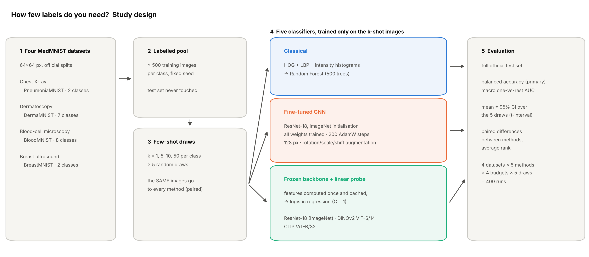
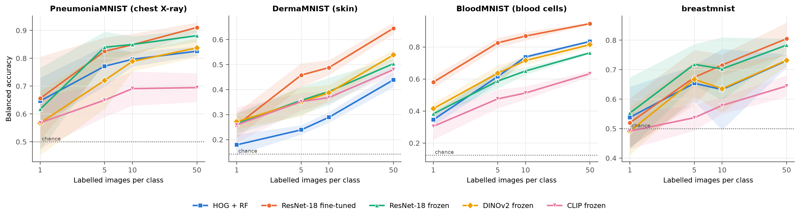
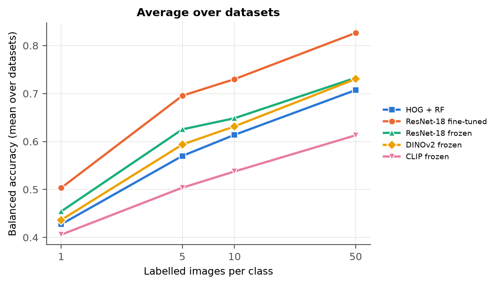

# How few labels do you need?

**A few-shot benchmark of classical, fine-tuned and frozen foundation-model classifiers on four medical imaging modalities (MedMNIST)**


Labelled medical images are expensive: every label costs an expert's time. This repository asks a simple question with a careful protocol: **with only 1, 5, 10 or 50 labelled images per class, which kind of classifier works best?** It compares a classical pipeline, a fine-tuned CNN and three frozen pretrained backbones on chest X-ray, dermatoscopy, blood-cell microscopy and breast ultrasound. Every method sees *the same* labelled images, and every setting is repeated over 5 random draws.

**Main finding:** with 5 or more labels per class, **fine-tuning a small ImageNet ResNet-18 beat every frozen backbone, including DINOv2 and CLIP**. It was best or tied-best in 12 of 16 settings. Its margin was largest on multi-class colour images (blood cells: +18 to +24 points of balanced accuracy over frozen ResNet-18). On the two greyscale binary tasks, a frozen ResNet-18 with a logistic regression matched fine-tuning at 5–10 labels, at a fraction of the compute.

---

## Study design

<p align="center"></p>

- **Paired draws.** For each dataset, label budget *k* and draw, every method gets exactly the same *k* labelled images per class, so differences between methods are never caused by a luckier draw.
- **Five draws per setting.** With 1–5 images per class, *which* images you get matters a lot. Results are reported as mean ± 95% t-interval over the draws.
- **Nothing is tuned on the test set**, and there is no validation split, because none exists at 1–5 labels. The logistic regression uses a fixed regularisation (C = 1), and fine-tuning a fixed schedule (200 AdamW steps, cosine). Each method is run the way a practitioner with *k* labels would have to run it.
- **Balanced accuracy** is the primary metric because DermaMNIST is strongly imbalanced. Macro one-vs-rest AUC is reported as well.
- **Frozen features are computed once** per dataset and cached, so the whole benchmark (400 runs) fits on a laptop CPU.

| Dataset | Modality | Classes | Labelled pool | Test images |
|---|---|---|---|---|
| PneumoniaMNIST | chest X-ray | 2 | 1,000 | 624 |
| DermaMNIST | dermatoscopy | 7 | 2,266 | 2,005 |
| BloodMNIST | blood-cell microscopy | 8 | 4,000 | 3,421 |
| BreastMNIST | breast ultrasound | 2 | 546 | 156 |

## Results

<p align="center"></p>

Balanced accuracy at 5 and 50 labels per class (mean over 5 draws; best per column in bold; full tables with confidence intervals and AUC in [`results/RESULTS.md`](results/RESULTS.md)):

| Method | Pneumonia 5 | Pneumonia 50 | Derma 5 | Derma 50 | Blood 5 | Blood 50 | Breast 5 | Breast 50 | Average rank |
|---|---|---|---|---|---|---|---|---|---|
| ResNet-18 fine-tuned | 0.825 | **0.911** | **0.458** | **0.645** | **0.825** | **0.945** | 0.674 | **0.805** | **1.50** |
| ResNet-18 frozen + LR | **0.840** | 0.881 | 0.357 | 0.504 | 0.587 | 0.763 | **0.718** | 0.783 | 2.31 |
| DINOv2 ViT-S/14 frozen + LR | 0.721 | 0.837 | 0.351 | 0.538 | 0.636 | 0.814 | 0.667 | 0.732 | 3.12 |
| HOG + LBP + histograms + RF | 0.771 | 0.825 | 0.239 | 0.439 | 0.615 | 0.834 | 0.654 | 0.730 | 3.56 |
| CLIP ViT-B/32 frozen + LR | 0.650 | 0.695 | 0.352 | 0.480 | 0.476 | 0.633 | 0.537 | 0.644 | 4.50 |

Chance level is 0.50 for Pneumonia and Breast, 0.14 for Derma and 0.125 for Blood. The average rank is taken over all 16 dataset × budget settings.

### What the results show

1. **Fine-tuning wins once there are a few labels.** From 5 labels per class upwards, fine-tuned ResNet-18 is the best method on DermaMNIST and BloodMNIST. Its paired advantage over the same network kept frozen is +0.18 to +0.24 on BloodMNIST and +0.10 to +0.14 on DermaMNIST, with 95% intervals that exclude zero (at every budget on BloodMNIST, and from 5 labels upwards on DermaMNIST).
2. **On greyscale binary tasks, a frozen network is enough at 5–10 labels.** On PneumoniaMNIST and BreastMNIST, frozen ResNet-18 + logistic regression is statistically indistinguishable from fine-tuning at 5 and 10 labels (paired intervals include zero). It costs seconds instead of minutes.
3. **Larger general-purpose foundation models did not help at this resolution.** This is the opposite of what the project set out expecting. DINOv2 was on par with the much smaller ImageNet ResNet-18: better on blood cells, worse on chest X-ray and ultrasound. CLIP ranked last overall. A likely reason, not tested here, is that 64×64 images are upsampled about 3.5× for these models, and CLIP's training on captioned internet photos rewards objects and scenes rather than fine texture.
4. **Classical features are still a serious baseline.** On BloodMNIST at 10 and 50 labels, HOG + Random Forest beats both frozen ResNet-18 and DINOv2 (0.834 vs 0.763 and 0.814 at 50 labels), because colour and cell shape are what separate those classes. It is the weakest method on dermatoscopy.
5. **One label per class is close to guessing.** At 1 label per class, results are near chance and very unstable: on BreastMNIST every method's interval includes chance, and on PneumoniaMNIST the intervals are up to ±0.15 wide. For every method, the biggest single gain comes from going from 1 to 5 labels per class.
6. **Compute differs by orders of magnitude.** All 80 fine-tuning runs took 71 CPU-minutes in total. All 320 Random Forest and logistic-regression fits together took under a minute, after a one-off feature extraction of a few minutes per model and dataset.

<p align="center">
  
</p>

## Quick start

```bash
git clone https://github.com/jaferi512/fewshot-medmnist-benchmark.git
cd fewshot-medmnist-benchmark
python -m venv .venv
.venv\Scripts\Activate.ps1            # Windows PowerShell;  Linux/macOS: source .venv/bin/activate
pip install torch torchvision --index-url https://download.pytorch.org/whl/cpu   # or a CUDA build
pip install -e ".[dev]"

pytest -q                              # unit tests
python -m fewshot smoke                # 1-minute end-to-end check on toy data, no downloads
python -m fewshot all --device cpu     # the full benchmark (about 1.5–2 h on a laptop CPU)
```

The first run downloads MedMNIST at 64×64 (about 280 MB for the four datasets) and the pretrained models (DINOv2 about 90 MB, CLIP about 600 MB). Progress is saved after every run: if the run stops, start the same command again and it continues where it left off.

On a slow or unstable connection, download the dataset files in a browser from the [MedMNIST Zenodo record](https://zenodo.org/records/10519652) (`<name>_64.npz`) and place them in `~/.medmnist` (on Windows: `%USERPROFILE%\.medmnist`).

Useful options:

```bash
python -m fewshot all --datasets pneumoniamnist bloodmnist      # fewer datasets (octmnist also supported)
python -m fewshot all --methods hog_rf dinov2_probe clip_probe  # fewer methods
python -m fewshot all --shots 1 5 10 50 100 --draws 10          # a bigger protocol
python -m fewshot all --size 224                                # full-resolution MedMNIST+
python -m fewshot analyze                                       # rebuild tables and figures only
python scripts/make_method_figure.py                            # redraw the study-design figure
```

**MedSigLIP (optional).** `google/medsiglip-448` is gated on Hugging Face: accept its terms on the model page, run `hf auth login`, then add `--methods ... medsiglip_probe`. It is a 400M-parameter model at 448×448, so use a GPU or Colab.

## Outputs

| File | Content |
|---|---|
| `outputs/runs.csv` | one row per run: dataset, method, shots, draw, seed, balanced accuracy, accuracy, AUC, time |
| `outputs/results/RESULTS.md` | ranking, per-dataset tables (mean ± CI), paired comparison of the best frozen model vs. fine-tuning |
| `outputs/results/figures/*.png` | balanced accuracy and AUC vs. labels per class, and the average over datasets |

The results in this repository's `results/` folder come from one full run on a laptop CPU (Windows, Python 3.13, PyTorch CPU build).

## Implementation notes

- **Inputs.** Images are handled as RGB; greyscale datasets are replicated to 3 channels. Each frozen model receives the 64×64 image resized to its native input size (224, or 448 for MedSigLIP) with its own normalisation, **without centre-cropping**, so lesions near the border are kept.
- **Features.** DINOv2: CLS token after the final layer norm (384-d). CLIP: projected image embedding (512-d). MedSigLIP: image embedding (1152-d). ResNet-18: global-average-pooled features (512-d). All are L2-normalised before the logistic regression.
- **Handcrafted baseline.** HOG (9 orientations, 8×8 cells), a uniform-LBP histogram and 32-bin per-channel intensity histograms (1,870 dimensions), fed to a 500-tree Random Forest.
- **Fine-tuning.** Whole ResNet-18, ImageNet initialisation, 128×128 input, 200 AdamW steps (lr 3e-4, cosine schedule), batch 16 sampled with replacement, random rotation, scale and translation. No flips, since left and right matter in chest X-rays.
- **Seeds.** Draw seeds are derived from (dataset, shots, draw) with a fixed hash, so every run is reproducible on any machine.

## Repository structure

```
src/fewshot/
  config.py       all settings (datasets, methods, protocol, training budgets)
  data.py         MedMNIST loading, labelled pool, reproducible paired draws
  handcrafted.py  HOG + LBP + histogram features
  foundation.py   frozen extractors (ResNet-18, DINOv2, CLIP, MedSigLIP) with feature caching
  finetune.py     end-to-end ResNet-18 fine-tuning
  methods.py      logistic-regression probe, Random Forest, metrics
  runner.py       runs every setting, appends to runs.csv, resumes after interruption
  analyze.py      mean ± CI, ranks, paired differences, tables and figures
scripts/          study-design figure
tests/            protocol (pools, draws, seeds), classifiers, statistics, end-to-end pipeline
results/          results and figures of the reported run
```

## Limitations

- **Low resolution.** MedMNIST images are small (64×64 here), and upsampling them probably handicaps the vision transformers most. Repeating the benchmark with `--size 224` is the most important next step.
- **One setting per method.** Each frozen model gets a single linear probe with fixed regularisation, and fine-tuning gets one fixed recipe. With labelled validation data either could be tuned, but few-shot settings do not have that data.
- **Model coverage.** The medical foundation model MedSigLIP is supported but was not run (it needs a GPU). OCTMNIST was replaced by BreastMNIST to keep downloads small; it is supported with `--datasets octmnist`.
- **Small test sets.** BreastMNIST has only 156 test images, so its intervals are wide and its rankings should be read with care.

## Citation

If you use this code, please cite MedMNIST v2 (Yang et al., *Scientific Data* 10, 41, 2023) and the models you evaluate: DINOv2 (Oquab et al., 2023), CLIP (Radford et al., 2021), and MedSigLIP (Google Health AI Developer Foundations, 2025) if used.

## License

MIT for the code. Datasets and pretrained models remain under their own licences. Research code, not a medical device.
